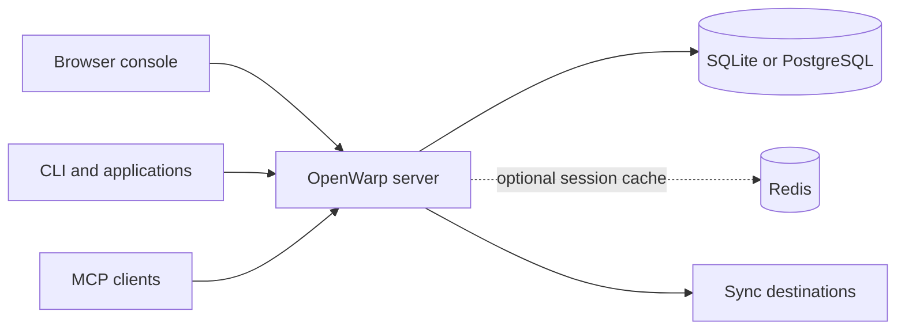

<div align="center">

# OpenWarp

### Your secrets. Your infrastructure.

A self-hosted secrets manager written in Rust.<br>
Manage secrets in the browser, inject them with the CLI, and sync them to the services that run your code.

[Quick start](#quick-start) · [Documentation](docs/README.md) · [CLI](docs/CLI.md) · [Self-hosting](docs/DEPLOY.md) · [Security](docs/SECURITY.md)

</div>

---

## One place for application secrets

OpenWarp groups secrets into workspaces, applications, and environments. Teams can collaborate in the console while applications and automation use scoped tokens, the CLI, or the API.

| Work | What OpenWarp provides |
| --- | --- |
| Organise | Workspaces, invitations, teams, custom roles, applications, environments, and secret paths |
| Develop | Secret references, personal overrides, version history, `.env` import/export, and process injection |
| Control access | Scoped service tokens, machine identities, MFA, OIDC sign-in, approval requests, and IP allowlists |
| Deliver | Provider integrations, deployment-triggered sync, manual sync, and audit events |
| Choose encryption | Server-side encryption for automation, or client-managed end-to-end environments |
| Automate | REST API, OAuth with PKCE, MCP tools, rotation schedules, and dynamic credentials |

There are no licence checks, paid feature gates, or configured seat and environment tiers. OpenWarp is an independent implementation inspired by the public [Phase Console documentation](https://docs.phase.dev/console). It does not use Phase enterprise code, assets, or branding. See the [feature reference](docs/FEATURES.md) for supported behavior and limits.

> [!IMPORTANT]
> OpenWarp handles sensitive data. Obtain an independent security and cryptography review before relying on it in production. Server-side encryption trusts the server with plaintext. End-to-end environments require client-managed keys and do not support the same automation paths. Read the [security model](docs/SECURITY.md).

## Quick start

### Run locally

You need Rust and Cargo. Run this from a checkout of the repository:

```bash
git clone https://github.com/hongkongkiwi/openwarp.git
cd openwarp
DATABASE_URL=sqlite://openwarp.db ADDR=127.0.0.1:8080 \
  cargo run -p openwarp-server
```

Open [http://127.0.0.1:8080](http://127.0.0.1:8080), register an account, and save the recovery kit offline. The first account is the instance owner. Use the console to create an application, choose an environment, and add a secret.

This is a local development setup. The server generates a development master key and stores it in the database. For a real deployment, supply an external key and enable production mode.

### Install the CLI

In another terminal, from the repository root:

```bash
cargo install --path crates/cli
openwarp login
openwarp init --app APP_ID --env ENV_ID
openwarp secrets
openwarp run -- ./your-app
```

Replace `APP_ID` and `ENV_ID` with IDs from your instance. `init` saves project defaults in `.openwarp.json`; `run` supplies secrets as environment variables to the child process. See [getting started](docs/GETTING_STARTED.md) for a complete walkthrough and the [CLI reference](docs/CLI.md) for authentication and command options.

### Self-host with Compose

The included Compose stack runs OpenWarp with PostgreSQL 17 and Redis 7. It requires a master key and database password:

```bash
export OPENWARP_MASTER_KEY="$(openssl rand -base64 32)"
export POSTGRES_PASSWORD="$(openssl rand -hex 24)"
docker compose up -d --build
```

Save both values in your deployment secret store before restarting or recreating the stack. Configure HTTPS, the public URL, persistent storage, and backups before exposing it. The [deployment guide](docs/DEPLOY.md) explains the full setup.

## How it fits together



The server hosts the console and API. SQLite keeps local setup small; PostgreSQL is available for deployed instances. Redis is optional. Secrets in standard environments are encrypted under per-environment keys wrapped by the instance master key. End-to-end environments keep decryption in the client.

## Documentation

| For | Read |
| --- | --- |
| First-time users | [Getting started](docs/GETTING_STARTED.md), [console guide](docs/CONSOLE.md) |
| Developers and automation | [CLI reference](docs/CLI.md), [API reference](docs/API.md), [integrations](docs/INTEGRATIONS.md) |
| Instance operators | [Deployment](docs/DEPLOY.md), [configuration](docs/CONFIGURATION.md), [backup and restore](docs/BACKUP.md) |
| Security reviewers | [Security model](docs/SECURITY.md), [feature boundaries](docs/FEATURES.md) |
| Contributors | [Architecture](docs/ARCHITECTURE.md), [development](docs/DEVELOPMENT.md) |
| When something fails | [Troubleshooting](docs/TROUBLESHOOTING.md) |

## Development

```bash
cargo test --workspace
cargo clippy --workspace --all-targets -- -D warnings
```

The repository includes crypto tests, database tests, HTTP integration suites, and browser-console checks. The [development guide](docs/DEVELOPMENT.md) lists prerequisites and commands, including the JavaScript checks that are separate from Cargo tests.

## Project boundaries

OpenWarp is a native Rust service, not a Cloudflare Worker. Its server needs operating-system networking and a database driver. Provider sync is server-side and sends plaintext to the configured destination; use destinations you trust. A recovery kit is private key material, not a replacement for a database backup.

The [documentation index](docs/README.md) links every guide. Start with [security](docs/SECURITY.md) and [backup and restore](docs/BACKUP.md) before storing secrets you cannot afford to lose.
