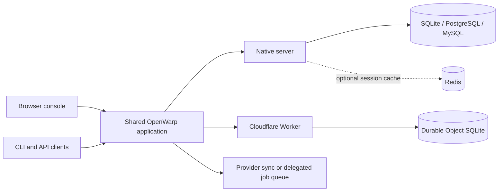

<div align="center">

# OpenWarp

### Your secrets. Your infrastructure.

A self-hosted secrets manager written in Rust.<br>
Store application secrets, control who can read them, and deliver them to your workloads.

[Run locally](#quick-start) · [Documentation](docs/README.md) · [Self-host](docs/DEPLOY.md) · [Security model](docs/SECURITY.md)

</div>

---

## One server, several ways to work

OpenWarp serves its browser console and HTTP API from the same application. Use the console to manage workspaces and review secret changes, the CLI to inject values into a process, or scoped credentials to connect your applications and deployment tools.

SQLite keeps local setup small. Native deployments can use PostgreSQL or MySQL/MariaDB, with Redis as an optional session cache. A separate Cloudflare Workers target runs the shared application with SQLite storage in a Durable Object. There is no separate frontend build.

| Your task | OpenWarp provides | Guide |
| --- | --- | --- |
| Organise a team's secrets | Workspaces, applications, environments, folders, tags, invitations, teams and custom roles | [Console](docs/CONSOLE.md) |
| Work locally | Process injection, import/export, secret references, personal overrides and encrypted files | [CLI](docs/CLI.md) |
| Control access | Scoped tokens, machine identities, workload identity, MFA, environment policy and approval requests | [Security](docs/SECURITY.md) |
| Deliver secrets | Provider sync, deployment-triggered updates and customer-run sync runners | [Integrations](docs/INTEGRATIONS.md) |
| Choose key custody | Server-side encryption, external KMS wrapping, delegated sync and client-held E2E keys | [Encryption](docs/ENCRYPTION.md) |
| Manage credentials | Rotation schedules, expiring dynamic credentials, X.509 and SSH certificate authorities | [Feature reference](docs/FEATURES.md) |
| Connect applications | REST API, language clients, Terraform, a GitHub Action and Kubernetes consumption | [Clients](docs/CLIENTS.md) |
| Review and recover | Version history, batched change requests, audit events, backup and restore | [Change requests](docs/CHANGE-REQUESTS.md) · [Backups](docs/BACKUP.md) |

OpenWarp is an independent implementation inspired by the public [Phase Console documentation](https://docs.phase.dev/console). It does not use Phase enterprise code, assets or branding. This checkout has no licence checks or paid feature gates; build options and deployment targets still affect availability.

There are no licence checks, paid feature gates, or configured seat and environment tiers. The enterprise surfaces (SAML, SCIM, X.509 PKI, SSH certificates, transit, workload identity, change requests and LDAP) are opt-in twice: a default build compiles them out, and a workspace needs a grant before it can use one. OpenWarp is an independent implementation inspired by the public [Phase Console documentation](https://docs.phase.dev/console). It does not use Phase enterprise code, assets, or branding. See the [feature reference](docs/FEATURES.md) for supported behavior and limits.

> [!IMPORTANT]
> Obtain an independent security and cryptography review before relying on OpenWarp in production. Server-side encryption trusts the server with plaintext. Client-held encryption has different recovery and automation requirements, and browser clients still trust the code served by the instance. Read the [security model](docs/SECURITY.md).

## Quick start

### 1. Start the server

You need Git, Rust with Cargo, and your platform's native compiler/linker tools.

```bash
git clone https://github.com/hongkongkiwi/openwarp.git
cd openwarp
DATABASE_URL=sqlite://openwarp.db ADDR=127.0.0.1:8080 \
  cargo run -p openwarp-server
```

Open [http://127.0.0.1:8080](http://127.0.0.1:8080). Register, complete the email-verification flow, and save your recovery kit privately. The first verified account becomes the instance owner. See the [walkthrough](docs/GETTING_STARTED.md) for account setup and the [troubleshooting guide](docs/TROUBLESHOOTING.md) if verification mail does not arrive.

This command binds to loopback and uses a local SQLite file. Development mode can store a generated master key in that database. Use dummy secrets while evaluating; production requires separately managed key material.

### 2. Save a secret

In the console, select a workspace, create an application, and open its Development environment. Add `EXAMPLE_GREETING` with value `hello-openwarp`, then select **Deploy changes**. Console drafts are not visible to other clients until deployed.

### 3. Read it from your application

In another terminal, install the CLI from the repository root:

```bash
cargo install --path crates/cli
openwarp login
openwarp orgs
openwarp apps --org ORG_ID
openwarp envs --app APP_ID
```

Replace the uppercase placeholders with IDs returned by your instance. From your application's directory:

```bash
openwarp init --app APP_ID --env ENV_ID
openwarp secrets
openwarp run -- sh -c 'printf "%s\n" "$EXAMPLE_GREETING"'
```

The final command should print `hello-openwarp`. Replace the shell command with your application's executable to inject its secrets. `init` saves project defaults in `.openwarp.json`; login credentials are stored separately.

[Complete walkthrough](docs/GETTING_STARTED.md) · [CLI authentication and commands](docs/CLI.md) · [Troubleshooting](docs/TROUBLESHOOTING.md)

## Choose your encryption boundary

| Mode | Who decrypts secret values? | Delivery path |
| --- | --- | --- |
| Server-side (`sse`) | The OpenWarp server | API reads, normal CLI injection and server-side provider sync |
| Delegated (`delegated`) | Authorised clients and a customer-run runner | Client-encrypted writes; the runner decrypts and syncs to providers |
| End-to-end (`e2e`) | Authorised clients | Local decryption with client-held keys; no server-side provider sync |

A database backup and its matching master key recover server-managed state. E2E recovery also needs the original client private key or another authorised key holder. Removing access cannot erase plaintext or keys already copied by a recipient.

The E2E compatibility creation path can generate a key on the server. That path does not provide the same key-custody boundary as client-generated creation. See [encryption and recovery](docs/ENCRYPTION.md) before choosing a mode.

## Deployment choices

| Target | Storage | Start here |
| --- | --- | --- |
| Local native process | SQLite | [Local walkthrough](docs/GETTING_STARTED.md) |
| Native server or container | SQLite, PostgreSQL or MySQL/MariaDB | [Deployment](docs/DEPLOY.md) |
| Included Compose stack | PostgreSQL 17, optional-to-the-server Redis 7, Caddy edge | [Compose setup](docs/DEPLOY.md#compose-setup) |
| Cloudflare Workers | SQLite-backed Durable Object | [Workers setup and limits](docs/DEPLOY.md#cloudflare-workers) |
| Kubernetes | Server deployment and workload secret consumption | [Kubernetes guide](docs/KUBERNETES.md) |

Native and Workers targets do not have identical protocol support. LDAP, SAML, SMTP, SSH file sync and the live WebSocket stream have native-only limits in this checkout. Consult the target-specific guide before selecting a deployment.

For production, configure HTTPS and the public origin, preserve the master key outside the database, bootstrap ownership privately, set signup policy, configure mail, and rehearse restoration. The included Compose file is a starting point, not a substitute for those decisions.

## How it fits together



Authentication establishes identity. Workspace membership, scopes, roles and environment policy then determine what that identity may do. Provider sync is separate from local persistence: a local deploy can succeed while a remote update fails. Inspect each integration's result.

[Architecture and source map](docs/ARCHITECTURE.md) · [API guide](docs/API.md) · [Client inventory](docs/CLIENTS.md)

## Documentation

| Reader | Recommended path |
| --- | --- |
| First-time user | [Getting started](docs/GETTING_STARTED.md) → [Core concepts](docs/CONCEPTS.md) → [Console](docs/CONSOLE.md) |
| Application developer | [CLI](docs/CLI.md) → [API](docs/API.md) → [Clients](docs/CLIENTS.md) |
| Platform engineer | [Deployment](docs/DEPLOY.md) → [Configuration](docs/CONFIGURATION.md) → [Backup and restore](docs/BACKUP.md) |
| Security reviewer | [Security model](docs/SECURITY.md) → [Encryption](docs/ENCRYPTION.md) → [Authentication protocol](docs/AUTH-PROTOCOL.md) |
| Contributor | [Architecture](docs/ARCHITECTURE.md) → [Development](docs/DEVELOPMENT.md) |

The [documentation index](docs/README.md) also covers workload identity, Transit encryption, change requests and integrations. Use [troubleshooting](docs/TROUBLESHOOTING.md) for failed login, denied access, missing values or deployment problems.

## Contributing

Read the [development guide](docs/DEVELOPMENT.md) and the repository's [agent and contributor rules](AGENTS.md) before changing code. The console lives in Rust source and requires a rebuilt server for browser checks. Do not run `cargo fmt` across this tree.

Run checks serially:

```bash
cargo clippy --workspace --all-targets -- -D warnings
cargo test --workspace -- --test-threads=2
node --test crates/server/tests/ui.test.cjs
```

These commands cover static checks, Rust tests and console-source tests. They do not establish live-provider compatibility or replace a browser check, a restore rehearsal or an independent security review. Never include database files, tokens, recovery kits or plaintext exports in contributions. The [development guide](docs/DEVELOPMENT.md) lists prerequisites and commands.


## Project boundaries

OpenWarp runs as a native Rust service or as a Cloudflare Worker with Durable Object storage. Platform-specific features and deployment limits are listed in the [deployment guide](docs/DEPLOY.md). Provider sync is server-side and sends plaintext to the configured destination; use destinations you trust. A recovery kit is private key material, not a replacement for a database backup.

The [documentation index](docs/README.md) links every guide. Start with [security](docs/SECURITY.md) and [backup and restore](docs/BACKUP.md) before storing secrets you cannot afford to lose.
