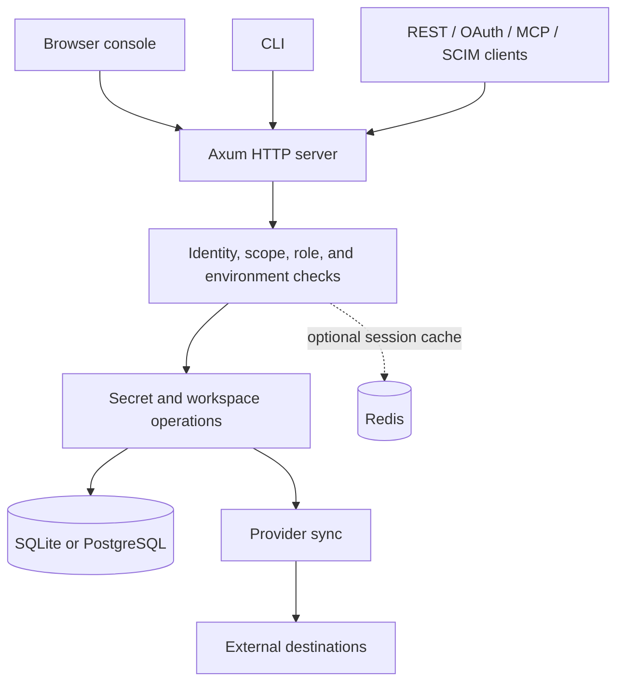

# Architecture

OpenWarp is a Rust workspace with a server, CLI, and cryptographic library. The server serves its browser console directly; there is no separate frontend build required to run it.

## Repository map

| Path | Responsibility |
| --- | --- |
| [`crates/server/src/main.rs`](../crates/server/src/main.rs) | Native startup, listener and background tasks |
| [`crates/server/src/app.rs`](../crates/server/src/app.rs) | Shared routing, authentication, authorisation and secret operations |
| [`crates/server/src/worker.rs`](../crates/server/src/worker.rs) | Workers fetch/scheduled entrypoints and Durable Object |
| [`crates/server/src/db.rs`](../crates/server/src/db.rs) | Native SQLite/PostgreSQL and Durable Object SQLite adapter, schema setup |
| [`crates/server/src/ui.rs`](../crates/server/src/ui.rs) | Embedded browser console |
| [`crates/server/src/e2e.js`](../crates/server/src/e2e.js) | Browser E2E cryptography |
| [`crates/server/src/integrations.rs`](../crates/server/src/integrations.rs) | Provider sync implementations |
| [`crates/cli/src/main.rs`](../crates/cli/src/main.rs) | CLI commands, OAuth login, credential storage, local E2E operations |
| [`crates/crypto/src/lib.rs`](../crates/crypto/src/lib.rs) | Encryption, key wrapping, and related primitives |
| [`crates/server/tests`](../crates/server/tests) | HTTP, authorisation, account, integration, and UI tests |
| [`scripts/backup.sh`](../scripts/backup.sh) | Database backup and retention helper |

## Request and storage flow



Authentication establishes the caller. OAuth scope checks, token environment scope, role permissions, membership, and environment policy can each narrow an action. A token accepted by authentication is not proof that the requested operation is authorised.

## Data model

```text
Instance
  Organisation (workspace)
    Members, teams, roles, settings, audit history
    Application
      Environments
        Secrets and version history
        Access policy and grants
        Integrations and managed-name sync state
        Rotation schedules and dynamic leases
```

Accounts can participate in multiple workspaces. Workspace membership and instance ownership are distinct. A standard secret is identified by its environment, path, and normalised key, not its key alone.

## Database adapter

The async database API has a common row representation. Native SQLite uses a synchronous connection protected by a mutex, with WAL and foreign keys enabled. Native PostgreSQL uses an async connection pool and translates `?` placeholders into numbered parameters. Its application-storage connection uses `NoTls`, so deployment must address database transport security.

On Workers, the same API executes queries against the synchronous SQLite handle in one Durable Object. It does not use a local database file or D1. Both deployments apply the shared schema and numbered migrations through the adapter.

Redis is an optional native revocation cache, not an authority for accepting a session. The database holds account state and rate limits. Workers excludes Redis.

Several server processes share one Postgres database and one master key. `instance_leases` keeps background work on a single replica. `live_events` carries audit-shaped change notices, and `GET /api/live` forwards the ones the caller may already read. The socket itself stays on the replica that accepted it; the table is what crosses process boundaries. A reconnect passes `since` and receives the matching rows still inside the hour-long retention before the live stream resumes. Each replica sends its own pings, so the socket survives an idle timeout at a proxy such as Cloudflare. SQLite remains a single-process database.

## Encryption paths

### Standard environments

The server generates an environment data key, wraps it with the instance master key, and encrypts secret material. Authorised reads decrypt on the server. Exports, process injection through the CLI, and provider sync depend on this server-side access to plaintext.

### End-to-end environments

The client generates the environment key and wraps it for an account's public key. The server stores ciphertext and per-user wrapped keys. The CLI or browser unwraps and decrypts locally. A compatibility creation path can generate the key server-side; it must not be described as keeping that key unknown to the server.

See the [security model](SECURITY.md) for recovery requirements and the browser-code trust boundary.

## External effects

Provider sync is separate from local secret storage. It sends shared non-sealed SSE values to remote systems. A local write and a remote provider update are not a single distributed transaction. Inspect sync results and remote state rather than assuming a successful local deploy proves every remote write completed.

Some integrations track previously managed names to constrain mirror deletions. That behavior is provider-specific. Rotation can trigger integration updates, and restored databases retain automation configuration. Isolate recovery rehearsals from outbound networks.

Audit log streams record delivery state and use bounded retries. They are not an unbounded durable queue with guaranteed eventual delivery; inspect failed or dropped deliveries.

## Client architecture

The console is embedded HTML, CSS, and JavaScript served by the Rust binary. Standard secret editing maintains drafts before deployment. E2E operations use a separate local cryptography path.

The CLI uses HTTP APIs rather than direct database access. User credentials and per-project defaults are separate: user configuration and OS credential storage hold login state, while `.openwarp.json` selects a host, application, and environment for a directory.

## Boundaries

- Native and Workers deployments share handlers but use different runtime adapters. Workers has explicit capability gaps listed in [deployment](DEPLOY.md#cloudflare-workers); native-only routes do not become portable merely by disabling default features.
- Database persistence does not imply that every background task has distributed leader election or a delivery guarantee.
- Protocol endpoints do not establish full compatibility with every external client or provider version.
- Cryptographic primitives and automated tests do not substitute for an independent audit.

[Development](DEVELOPMENT.md) · [Authentication protocol](AUTH-PROTOCOL.md) · [Security model](SECURITY.md) · [Documentation index](README.md)
